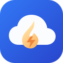
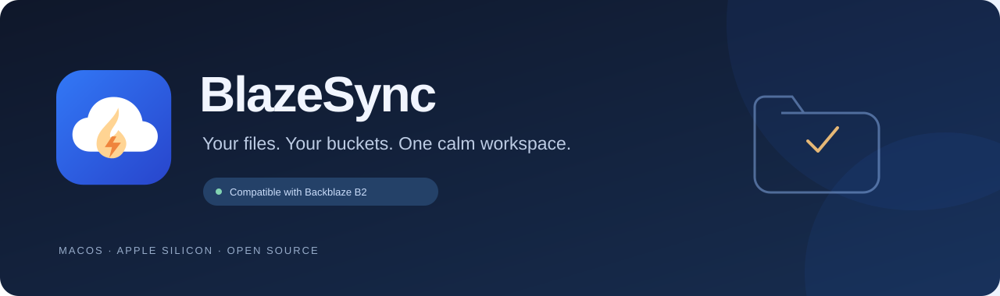
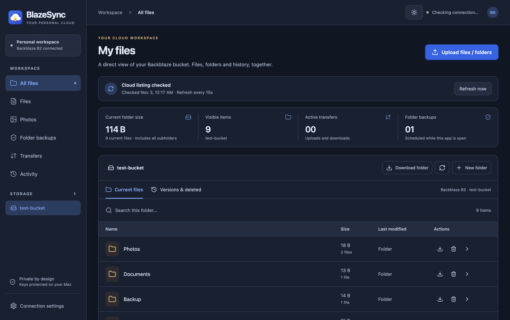
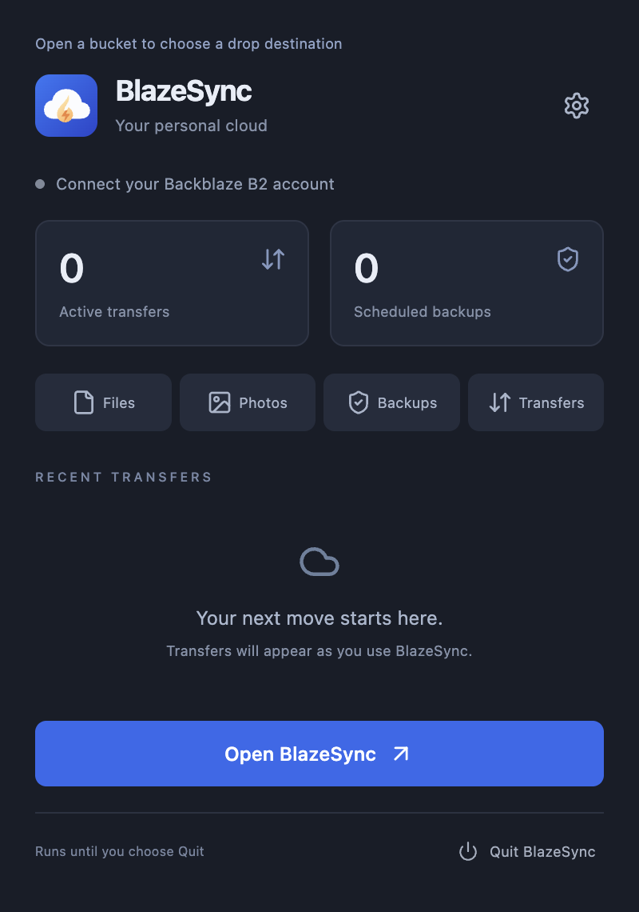

<div align="center">
  
  <h1>BlazeSync</h1>
  <p><strong>Your files. Your buckets. One calm workspace.</strong></p>
  <p>A desktop cloud-storage manager compatible with <a href="https://www.backblaze.com/cloud-storage">Backblaze B2 Cloud Storage</a>.</p>
  <p>
    <a href="https://github.com/kvianAR/BlazeSync/releases/latest"></a>
    <a href="https://github.com/kvianAR/BlazeSync/actions/workflows/ci.yml"></a>
    <a href="LICENSE"></a>
    
    
  </p>
  <p>
    <a href="https://github.com/kvianAR/BlazeSync/releases/latest/download/BlazeSync-macos-arm64.zip"><strong>Download for Mac</strong></a>
    &nbsp;·&nbsp; <a href="#install-from-terminal">Terminal install</a>
    &nbsp;·&nbsp; <a href="docs/backblaze-b2.md">Connect Backblaze B2</a>
    &nbsp;·&nbsp; <a href="https://github.com/kvianAR/BlazeSync/issues">Report an issue</a>
  </p>
</div>



BlazeSync brings B2 files, folders, transfers, version history and one-way backups into one desktop app. Browse your buckets, drop in a project folder, watch upload/download speed, and keep the app nearby in the macOS menu bar.

**Independent client.** BlazeSync is compatible with Backblaze B2 through its documented APIs; it is not made by, affiliated with, or endorsed by Backblaze. Backblaze Personal Backup is a separate product and is not supported as a storage endpoint.

## A workspace built around your files



| Capability | What you can do |
| --- | --- |
| **Files and folders** | Browse buckets and nested folders, create folders, search loaded listings, and download a complete folder with its structure. |
| **Selection and moves** | Select multiple files/folders for download, delete or move. Rename individual items and confirm destination overwrites. Moves verify copies before removing current sources. |
| **Storage and billing** | Scan current files, retained versions and unfinished uploads. Project 30-day USD storage cost with the account-wide 10 GB allowance and a local budget alert. |
| **Drag and drop** | Drop files/folders on the main app, mini panel or native menu-bar icon. The selected bucket/folder is the upload destination. |
| **Accurate folder sizes** | See recursive current-file totals and per-folder file counts across all listing pages, not just the first 1,000 objects. |
| **Transfers** | Follow queued/running/completed/failed/cancelled states, progress, estimated speed and remaining time. |
| **Versions and deletion** | Separate current objects from stored versions and delete markers; restore supported versions or deliberately purge an exact file's history. |
| **Folder backups** | Schedule one-way uploads of new/changed local files. Local deletion does not remove the cloud copy. |
| **Photos** | Browse common image formats, including HEIC/RAW classification, and open supported original-image previews. |
| **Private connection** | Enter just Key ID and Application Key. Endpoint and bucket discovery are automatic; saved credentials stay encrypted and locked. |
| **Menu-bar app** | Keep BlazeSync running without a Dock icon. Close the window to hide it; choose Quit to stop it. |
| **Light and dark** | A consistent interface with saved theme preference and configurable cloud-list refresh. |

### Storage pricing

The Storage & billing page uses Backblaze B2 Fundamentals public pricing, verified on November 3, 2026. The first 10 GB is free once per account. Storage above this allowance costs $6.95 per decimal TB per 30 days. At constant usage, 100 GB projects to $0.63 and 1 TB to $6.88 for 30 days.

The billing page includes a **Pay on Backblaze** shortcut to the official billing portal. Choose your monthly payment day to receive a daily system notification from seven days before that date through the date itself, after 9 AM local time. Keep BlazeSync running in the menu bar and allow its macOS notifications. Days 29–31 use the final day of shorter months. Turn reminders off from the same page. Your chosen date is saved locally.

The app projects storage charges at the current scanned amount. Actual invoices use byte-hours and may include egress, transactions, taxes or account-specific terms. Restricted keys and incomplete scans show visible-storage coverage and an estimate range. Refresh usage after external cloud changes. The rate is a dated published snapshot, with an official pricing link in the app.

Moves and ordinary deletion can retain older B2 versions, which continue using storage. Review Versions & deleted before choosing an explicit permanent purge. Cloud moves copy and verify destinations before removing sources. Concurrent changes or failures can leave a partial move with verified destination copies preserved.

[Backblaze public pricing](https://www.backblaze.com/cloud-storage/pricing)

## Download and install

**Available now:** macOS, Apple Silicon (`arm64`). The app declares **macOS 13 or newer**. There are no prebuilt Intel, Windows, Linux or Android clients in this release.

1. [Download BlazeSync for Apple Silicon](https://github.com/kvianAR/BlazeSync/releases/latest/download/BlazeSync-macos-arm64.zip).
2. Optionally compare it with the release's [SHA-256 checksum](https://github.com/kvianAR/BlazeSync/releases/latest/download/SHA256SUMS.txt).
3. Unzip it and move **BlazeSync.app** to **Applications** or **~/Applications**.
4. Open it, then click the cloud icon in the macOS menu bar and select **Open BlazeSync**.

The release is locally signed but **not Apple-notarized**. If macOS blocks the app, review **System Settings → Privacy & Security → Open Anyway** after confirming the download came from this repository. Do not disable macOS security globally. See [troubleshooting](docs/troubleshooting.md).

### Install from terminal

The installer downloads the latest published ZIP, checks its SHA-256 and local code signature, and installs into `~/Applications/BlazeSync.app`. No `sudo` is needed. **Quit an existing BlazeSync instance first.**

```bash
curl --proto '=https' --tlsv1.2 -fL \
  https://raw.githubusercontent.com/kvianAR/BlazeSync/main/scripts/install-macos.sh \
  -o /tmp/blazesync-install.sh

bash /tmp/blazesync-install.sh
open "$HOME/Applications/BlazeSync.app"
```

The script is available for [review here](scripts/install-macos.sh). To update an app already installed elsewhere, point it at that app's parent directory:

```bash
bash /tmp/blazesync-install.sh --prefix "/path/to/your/app-folder"
```

It updates that same `BlazeSync.app`; it does not create versioned app clones. Connection settings are kept separately from the bundle. The installer refuses to overwrite a running app or a symbolic-link destination.

### Build from source

Use Node.js 24 LTS (minimum 22.12.0) on a Mac:

```bash
git clone https://github.com/kvianAR/BlazeSync.git
cd BlazeSync
npm ci
npm test
npm run build
npm start
```

For a packaged app:

```bash
npm run package
# Quit BlazeSync before updating its app files.
npm run update-app
open outputs/BlazeSync.app
```

[Development guide](docs/development.md) · [Code map and tests](docs/testing.md)

## Connect your Backblaze B2 account

1. Create/select a bucket in [Backblaze B2](https://secure.backblaze.com/b2_buckets.htm).
2. Create a dedicated key under [Application Keys](https://secure.backblaze.com/app_keys.htm).
3. Open BlazeSync → **Connection settings**.
4. Paste **Application Key ID** and **Application Key**, then connect.

BlazeSync discovers the endpoint, region and permitted bucket names. If a restricted key hides its bucket name, the app asks for that name once. Connected credentials remain masked/locked until you choose **Change connection**. Temporary network loss does not sign you out; revoked or expired keys need replacement.

Use the least bucket access you need. Listing, download, upload and deletion require the corresponding B2 permissions. **Never put your key in an issue, screenshot, commit or README.**

[Full B2 setup and permissions guide](docs/backblaze-b2.md)

## What “sync” and “delete” mean here

- **Cloud refresh** checks changes made in B2: 15/30/60-second or manual refresh, plus refresh on focus. This is not two-way local-folder sync.
- **Folder backup** uploads new/changed local files. Local deletion keeps the cloud copy. Keep BlazeSync open and your Mac awake for scheduled jobs.
- **Current files** excludes old versions and delete markers. The B2 web console can still show retained history for a hidden file.
- **Hide current file** removes the current object from the live list; old versions can remain.
- **Delete all versions** requires a separate permanent-deletion confirmation and verifies cloud history afterward. Permissions, Object Lock, retention and legal holds are never bypassed.

Backblaze bills storage and usage directly. Review its [current pricing](https://www.backblaze.com/cloud-storage/pricing). Recursive sizes count current files, not retained-version storage or an estimated bill.

## Keep it in your menu bar



Closing the window keeps the app available from the cloud icon. **Open BlazeSync** returns to the full workspace. **Quit BlazeSync** stops the app and removes the icon. The panel shows your upload destination and recent transfers.

## Verified, with clear limits

Before publishing, **56 unit/regression tests and 45 packaged-desktop checks passed**; including installer regressions. Tests exercise folder pagination, safe paths, connection discovery, IPC, drag/drop, cancellation, backups, version handling, a 17 MiB multipart upload and shutdown. Desktop cloud tests use an isolated profile and a local S3 protocol fixture.

Live read-only metadata checks also confirmed recursive totals. Live permanent deletion was not used for validation. Multi-GB live transfers, prolonged outages, sleep during transfers and broader macOS configurations still need more field testing.

Current limits include **no restart-resumable transfers, two-way sync, Finder drive mount, client-side encryption, cloud rename/move or generated photo thumbnails**. Backups use size/modification time rather than content hashes. HEIC/RAW preview needs an external viewer; supported previews download originals. In-app version restore is limited to 5 GB.

[Testing](docs/testing.md) · [Configuration](docs/configuration.md) · [Troubleshooting and limits](docs/troubleshooting.md)

## Contribute

Issues and focused pull requests are welcome. Read [CONTRIBUTING.md](CONTRIBUTING.md), use a disposable test bucket for cloud experiments, and report sensitive vulnerabilities through [SECURITY.md](SECURITY.md).

Source code is [MIT licensed](LICENSE). Dependencies and their brands retain their own licenses and trademarks; see [NOTICE.md](NOTICE.md).

---

Built by [kvianAR](https://github.com/kvianAR). Compatible with **Backblaze B2 Cloud Storage**.
